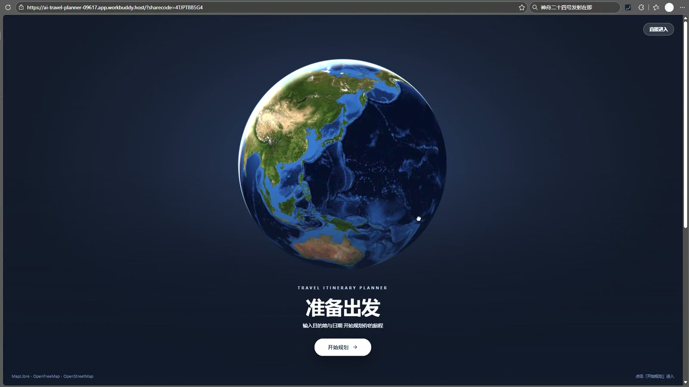
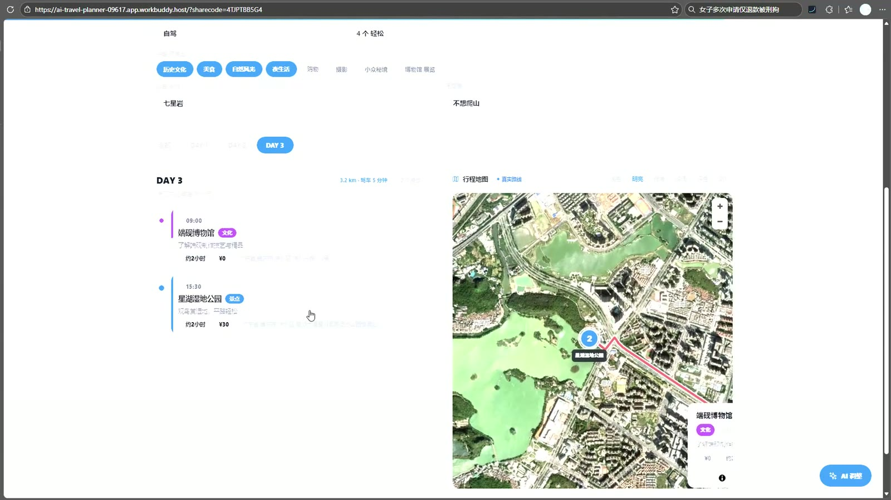
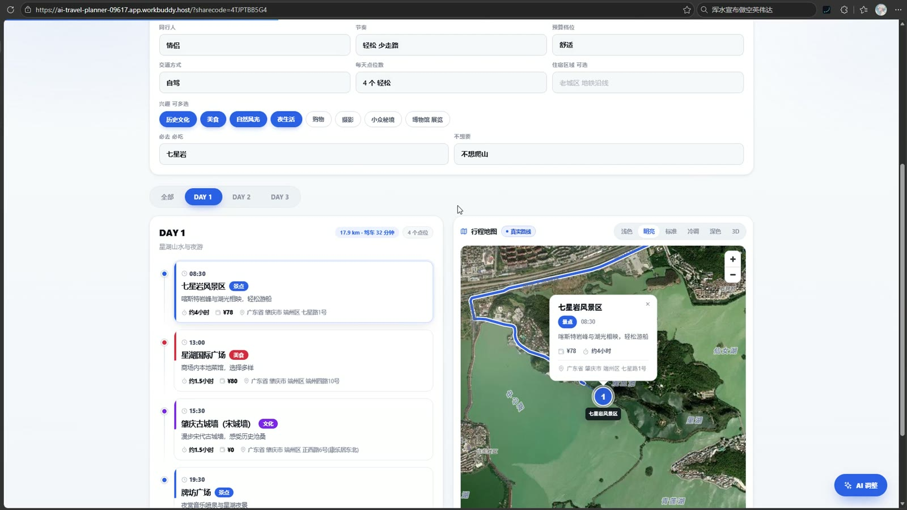
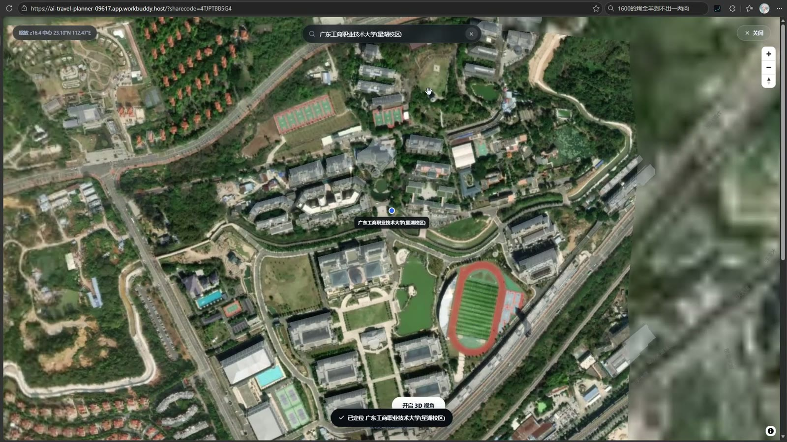
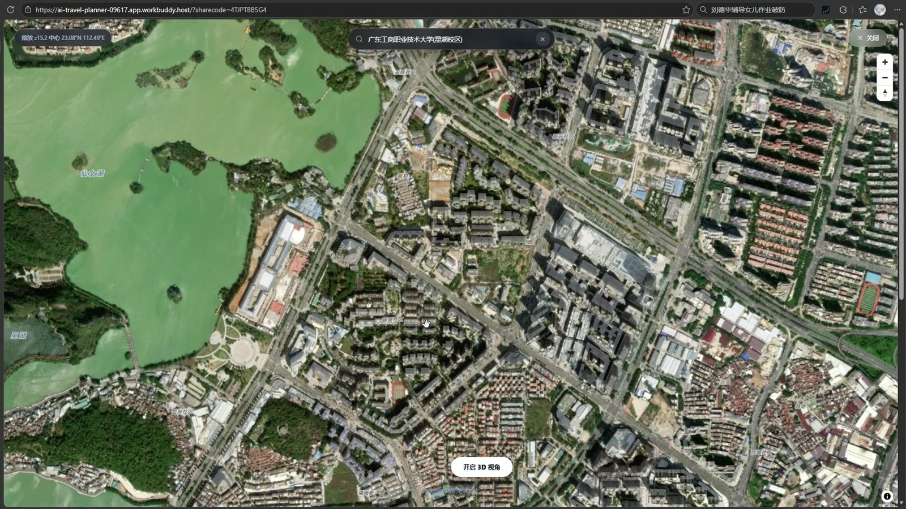

# 作品介绍文档

**作品名称**：行程规划 — AI 旅行路线规划器
**参赛赛道**：第九届传智杯 · AI WEB 网页开发挑战赛（团队赛）
**在线演示**：https://ai-travel-planner-09617.app.workbuddy.host/?sharecode=4TJPTBB5G4
**源码仓库**：https://github.com/YiFan-1010/ai-travel-planner
**团队规模**：1 人（需求、架构、前端、AI 编排、服务端、测试、部署、文档独立完成）

---

## 一、项目详情及使用方式

### 1.1 项目解决什么问题

市面上的 AI 旅行助手大多止步于输出一段文字建议，真正拿去执行时会遇到三个问题：地点可能是模型编造的、路线是用直线连起来的、顺序根本没法照着走。本项目把这三点逐一解决——**地点由地理编码工具核实真实坐标，路线由 OSRM 沿真实道路计算，行程顺序经跨度与密度体检后才输出**。最终交付的不是一段话，而是一份能直接照着走的多日行程。

### 1.2 在线使用（推荐，零配置）

打开在线演示链接，无需注册、无需填写任何 API Key，按以下步骤操作：

1. 在表单中填写目的地与出行天数，或直接点击输入框右侧麦克风说一句「我想去成都玩三天」，系统自动填好目的地并推算返程日期
2. 按需展开九维偏好：同行人、节奏、预算、交通方式、每日点位数、住宿、兴趣、必去、不想要
3. 点击「生成行程」，页面流式显示进度：「参考 5 条本地知识 · 已写 2209 字」→「核对地点坐标」→ 逐个绿勾
4. 查看结果：左侧每日时间轴卡片与右侧地图编号图钉一一对应，路线沿真实道路绘制；顶部显示天数、点位数、预算
5. 点开「规划依据」查看本次检索到的本地知识；可用自然语言在 AI 调整里说「第二天太赶了，去掉一个点」；可拖拽卡片调整顺序、切换深色主题、导出长图
6. 点击右上角「世界模型」，可从地球一路搜索并放大到任意地点街区，支持卫星影像与 3D 建筑

> 链接需带 `?sharecode=` 参数（上方地址已包含）。

### 1.3 本地运行

```bash
git clone https://github.com/YiFan-1010/ai-travel-planner
cd ai-travel-planner
npm install
cp .env.example .env      # 填 DEEPSEEK_API_KEY、AMAP_KEY
npm start                 # 构建并启动 http://127.0.0.1:8080
```

- 环境要求：Node.js ≥ 18、npm ≥ 9、支持 WebGL 与 SSE 的现代浏览器；无需 Docker、数据库、Redis
- 运行时依赖仅 1 个（`maplibre-gl`），服务端零第三方依赖，仅用 Node 内置 `http/fs/path/zlib`
- 也支持 `npm run dev`（纯前端开发）与 Docker 两阶段构建；纯静态托管时前端自动切换为「访客自带 Key」模式
- 应用启动时探测 `/api/health` 自动判断运行形态，用户无需选择

### 1.4 项目规模

代码 11,436 行（前端 7,541 / AI 模块 3,171 / 服务端 689），构建产物 gzip 约 360 KB，完整开发过程见 Git 提交历史，技术文档 27 页，演示视频 5 分 04 秒。

---

## 二、项目亮点

1. **坐标不是模型猜的**：四阶段 Agent 流水线中，模型只负责决定「去哪、怎么排」，地名一律经地理编码工具换成真实坐标；查不到的地点会触发模型换点重查，界面以绿勾/红叉如实呈现
2. **路线走真实路网**：接入 OSRM，行程是否可行一眼可辨；针对 OSRM 吸附点偏移（镇区实测可达 350 米以上）主动画「接驳虚线」，把局限如实告诉用户，而不是假装完美
3. **RAG 无需向量模型也能用**：DeepSeek 没有 embedding 接口，改用 BM25 + 中文 bigram，零依赖零网络；20 城 128 条结构性知识 + 10 条通用兜底，冷门城市不会零召回；结果页可展开「规划依据」看到具体引用了哪几条
4. **零 Key 可用、零数据成本**：线上由 Node 代理持有大模型 Key，访客打开即用；地图、地理编码、路线、卫星影像全部使用免费开源数据源，全链路 WGS-84
5. **有记忆点的视觉体验**：MapLibre globe 开场、三层描边路线的生长与流光动画、按缩放分档切换的 NASA GIBS / Esri 双源卫星影像、3D 建筑与地形、深色主题 View Transition 圆形扩散
6. **交互完成度高**：语音输入、AI 自然语言调整（diff 定位变化的天）、拖拽排序、多方案对比、命令面板（⌘K）、Canvas 导出长图、离线 Canvas 降级示意图、行程本地持久化
7. **工程上可交付**：TypeScript strict、前后端共用一层零依赖代理、gzip + LRU 缓存、IP 三层限流、密钥不出服务端、SPA fallback、Docker 两阶段构建

---

## 三、AI 技术落地使用情况概述（含测试验证）

### 3.1 大模型落地方式

仅使用 DeepSeek（`deepseek-chat`），通过服务端 `/api/chat` 以 SSE 流式转发。流式是必须的：非流式 + 8192 token 在实测中要 3–5 分钟，用户会以为卡死；改为流式后实时显示「已规划 N 天 · M 个地点」与字数进度，两段式超时（首字节 60 秒 / 空闲 90 秒）。服务端强制覆盖 `model` 参数并对每个 IP 做小时、天、全局天三层限流，防止额度被刷。

### 3.2 四阶段 Agent 编排

```
规划 ──→ 落地 ──→ 体检 ──→ 修正
模型只定    并发地理编码   跨度/缺口    问题清单
主题与地点  换成真实坐标   密度检查     回喂模型（最多一轮）
```

模型在第一阶段被提示词明确禁止输出坐标，从根源上减少幻觉；第四阶段只改有问题的部分，避免整份行程被重写。

### 3.3 检索增强（RAG）

语料只写稳定的结构性知识（空间关系、时间窗、避雷），不写会过期的票价与营业时间。两处召回盲区已解决：用户说「避坑」而语料写「商业化重」，按标签补通用检索词；冷门城市与语料零交集、得分恒为 0，用通用条目降权补齐。查询侧把「N 天 / N 日」归一为「几天」，避免天数差异扰动检索。

### 3.4 针对 AI 输出的测试与验证

| 验证手段 | 做法 | 实测结果 |
|:---|:---|:---|
| 坐标可信度 | 地理编码工具逐个核对，失败触发换点重查 | 15 个地点全部命中（15/15） |
| 限流回归 | 高德个人 Key QPS 仅 3，并发变体重试瞬时冲到 5–6 次/秒，把限流下沉为服务端 340 ms 串行闸门 | 从「13 命中 + 一轮修正」提升到「15 一次全中」，总耗时 19.1 s → 11.6 s |
| 行程合理性 | 体检阶段检查单日跨度、地点缺口、点位密度 | 越界行程在输出前被拦截并回喂修正 |
| 路线可行性 | OSRM 返回真实里程与耗时，异常时直线兜底并给出状态提示 | 三层路线 + 接驳虚线如实呈现吸附偏差 |
| 端到端 | 无痕窗口按「输入 → 生成 → 地图 → AI 调整 → 世界模型」全流程回归 | 首页 200、`/api/health` 正常、控制台 0 报错 |
| 密钥泄露 | 检索打包产物与 Git 历史中的 `sk-` | 0 命中 |

语音输入使用浏览器原生 Web Speech API，不消耗 Token、不需要额外 Key；AI 调整在免 Key 模式下一并走代理（支持 `stream:false`），避免直连 401。

---

## 四、关键技术与选型理由

| 领域 | 技术 / 数据源 | 选型理由 |
|:---|:---|:---|
| 前端工程 | Vite 6 + TypeScript 5（strict） | 单页应用零框架，类型安全，构建产物小 |
| 地图渲染 | MapLibre GL JS 5.24 | 支持 globe 投影、3D 建筑、地形；唯一运行时依赖 |
| 底图 | OpenFreeMap（基于 OSM） | 免费无 Key，矢量瓦片可定制样式 |
| 卫星影像 | NASA GIBS（宏观）+ Esri World Imagery（城市级） | 双源按缩放分档淡出，城市级可看清屋顶；限制 maxzoom 避免超分辨率灰块 |
| 路线 | OSRM | 真实路网，比直线更能暴露不合理行程 |
| 地理编码 | 高德 Web 服务（服务端代理）+ Photon 兜底 | Photon / Nominatim 国内 DNS 污染实测不可达；高德服务端做 GCJ-02 → WGS-84 转换 |
| 坐标系 | 全链路 WGS-84 | 商业地图 GCJ-02 与 OSM / 卫星影像混用会产生 300–700 米错位；提示词强制模型输出 WGS-84 |
| 大模型 | DeepSeek（SSE 流式） | 兼容 OpenAI 格式、中文效果好、成本低；不引入第二家模型 |
| 检索 | BM25 + 中文 bigram | 无 embedding 接口、不额外下载向量模型，首屏不受影响 |
| 服务端 | Node 原生 http / fs / path / zlib | 零依赖，SSE 不经过缓冲层，附 gzip + LRU + 三层限流 |
| 部署 | Node 单进程 + Docker 两阶段 | 一个进程同时提供静态页面与 `/api`，密钥只存在于服务端 |

**两个有代表性的技术决策**：

- **不用 `flyTo` 做世界模型飞行**：其 zoom 曲线是指数式的，2.5 秒就冲完 43% 路程；一次性 `easeTo` 跨 14 级会让 `tile.z` 追不上 `transform.zoom`，超出 overscale 后整屏不渲染。改为「先对准落点 → 并行做坐标校准 → 逐帧推 zoom、中心锁死」三段式，并加 15 秒 watchdog 与 reduced-motion 兜底。
- **卫星影像必须限制最大级别**：Esri 超出原生分辨率会返回 HTTP 200 的灰底「Map data not yet available」图，MapLibre 会当正常瓦片渲染成满屏灰块。通过 source `maxzoom: 18` + 16.5→18.2 淡出 + globe `maxZoom: 19` + HUD 提示共同解决。

---

## 五、项目相关图片与照片

以下 6 张均为本项目实际运行画面，从提交的演示视频中逐帧抽取（1920×1080 录制，导出为 1600 px 宽 JPG），存放于 `screenshots/` 目录。

**图 1　开场地球与「准备出发」**



**图 2　九维偏好输入表单与语音输入**


**图 3　生成结果：每日行程时间轴与真实道路地图**



**图 4　点位详情卡片与地图联动**



**图 5　世界模型：城市级卫星影像**



**图 6　世界模型：3D 视角下的湖泊与城市街区**



> 团队为单人开发，无线下合影或活动照片；全部项目影像为软件运行截图。演示视频中亦包含完整动态演示。

---

## 六、项目此前是否发表过或获奖

- **未在任何期刊、会议或媒体发表论文或文章，未参加过其他赛事，未获得任何奖项**。本项目为本次传智杯专门开发并首次提交。
- 源码于 2026 年 11 月以 Public 仓库形式托管在 GitHub（MIT 许可），属于代码开源与开发过程留痕，**不属于成果发表或获奖**。
- 早期原型（`archive/v0-tmap.html`、`archive/v1-single-file.html`）仅作为版本演进记录保存在仓库内，未对外发布、未用于任何其他比赛或商业用途。
- 项目使用的第三方开源组件与地图数据（MapLibre、OpenStreetMap / OpenFreeMap、OSRM、Photon、NASA GIBS、Esri World Imagery）均按其各自许可使用并保留署名，与本作品是否发表无关。

---

## 七、是否基于其他项目优化及优化说明

**本作品不是基于任何第三方项目、开源模板或他人代码的二次开发**，业务代码、提示词、语料、样式与服务端均为独立编写。但存在**自身版本的持续迭代**，演进链路与优化部分如下：

| 阶段 | 形态 | 相对上一版的主要优化 |
|:---|:---|:---|
| v0 原型 | 腾讯地图单文件 HTML | 验证「AI 生成行程 + 地图展示」的可行性；使用 GCJ-02 坐标系 |
| v1 基线 | 开源地图版单文件 HTML（约 124 KB） | 换 MapLibre + OpenFreeMap，全链路统一 WGS-84，消除 300–700 米坐标偏移；加入 3D 建筑、卫星双源、globe 开场、OSRM 真实路线、接驳虚线、深色主题、命令面板、导出长图、离线降级；内置成都 3 日示例，全部免 Key |
| v2 参赛版（当前） | Vite + TypeScript 工程 + Node 代理 | ① 单文件拆为模块化工程，TS strict 类型约束<br>② 新增零依赖 Node 服务端代理，密钥不再出现在前端，线上访客零 Key 可用；SSE 流式、gzip、LRU、三层限流<br>③ AI 由「一次调用吐 JSON」重构为「规划 → 落地 → 体检 → 修正」四阶段 Agent，坐标交给工具核实<br>④ 新增本地 RAG（20 城 128 条 + 通用兜底）与「规划依据」可解释面板<br>⑤ 新增语音输入、AI 自然语言调整、多方案对比<br>⑥ 高德地理编码 QPS 串行闸门，定位 15/15、19.1 s → 11.6 s<br>⑦ 世界模型搜索改为三段式相机控制，修复放大后整屏不渲染<br>⑧ 修复 `.pin-wrap` 覆盖 MapLibre 定位样式导致的图钉偏移、开场地球未转完就进主界面、免 Key 模式 AI 调整 401 等问题<br>⑨ 补齐参赛材料：27 页技术文档、演示视频（普通话配音）、README、部署脚本、Dockerfile |

**关于「使用开源组件」与「基于其他项目」的区分**：项目依赖 MapLibre GL JS、OpenFreeMap / OSM、OSRM、Photon、NASA GIBS、Esri World Imagery 等开源库与开放数据服务，并调用 DeepSeek API，这些属于常规技术依赖；所有业务逻辑、AI 编排、知识语料、交互设计与视觉实现均为本项目原创。

---

## 附：材料索引

完整链接与文件清单见《作品文件清单》，技术实现细节见《技术文档》（27 页），动态演示见《演示视频-配音版.mp4》（5 分 04 秒）。
